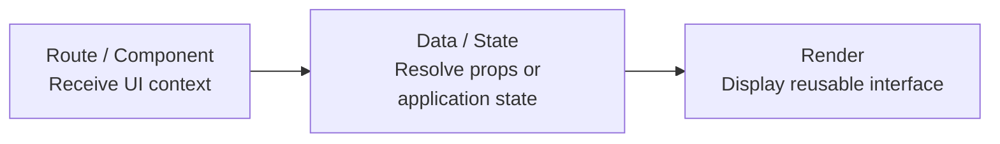

# MetaTransfer Frontend

**Portfolio project** · The React frontend for a transfer-management application.

## Overview

The React frontend for a transfer-management application.

## Technology Stack

- `Node.js`
- `React`
- `HTML`
- `CSS`
- `JavaScript`

## How the Repository Works

| Stage | Responsibility |
|---|---|
| **Route / Component** | Receive UI context |
| **Data / State** | Resolve props or application state |
| **Render** | Display reusable interface |

## Concepts Covered

- Component-based UI
- State and props
- Event handling
- Reusable layout
- Client-side rendering

## Repository Map

- `.gitignore`
- `package-lock.json`
- `package.json`
- `public`
- `src`

## Recruiter Summary

This repository demonstrates practical implementation skills, repository organization, and an end-to-end understanding of the project workflow. It is suitable as a focused example of applied software or data work.

---

Documentation is concise and project-focused; source code was not modified.
